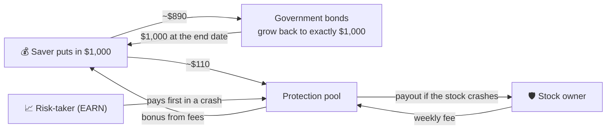

# InsureVEX

**Crash protection for stock owners, paid for by savers who can't lose their money.**

[Live app](https://insurevex.vercel.app) · [Big-test results (`/admin`)](https://insurevex.vercel.app/admin) · [Research (`/docs`)](https://insurevex.vercel.app/docs) · [API health](https://insurevex-api-30d9bd1c.centralindia.cloudapp.azure.com/api/health) · [Arc Studio project](https://studio.arc.io/app/7356f9d2-e713-4576-a2f0-4acfd62806e4)

Live on three testnets: **Whitechain** (settles in USDT), **Hedera** (tokenised stocks and bonds, plus an AI-agent buyer) and **Arc** (settles in USDC, built in Arc Studio).

> Everything here runs on test networks with test money. Nothing is a real financial product yet.

---

## The problem

Half of investors think AI is a bubble. The other half think it's too big to fail. **Both are nervous.**

- **People who own stocks** (NVIDIA, Reliance, Toyota…) are sitting on gains, and one bad week can wipe out months. Protection exists (options), but it's complicated, expensive, and usually only for US stocks at big brokers.
- **People with savings** want their money back for sure, but government bonds alone pay little. Everything that pays more puts their money at risk.

## The idea: three people who need each other

| | Who | What they want | What they get |
|---|---|---|---|
| 🛡️ **PROTECT** | Someone who owns a stock, on **any exchange, at any broker** | Not to get wiped out by a crash | Pays a small weekly fee. If the stock falls more than 3% in the week, they get paid the extra fall, up to 10% |
| 💰 **SAVE** | Cautious money: savers, family offices, DAO and crypto treasuries | Their money back, guaranteed, plus more than bonds | **Their full amount back at the end date**, plus bonus payments from the fees |
| 📈 **EARN** | Someone who thinks people overpay for fear | Higher returns, and accepts risk for them | Collects the protection fees. **Pays first when a crash happens**, so savers don't have to |

### How the money moves



1. A saver puts in $1,000 for 3 years. **About $890 buys government bonds that grow back to exactly $1,000.** That's the guarantee, and that money never touches the stock market.
2. The **~$110 left over**, plus the risk-taker's money, forms the pool that pays for crashes.
3. Stock owners pay a small fee for protection. **The payout money is locked away the moment protection is sold**, so the pool can never promise money it doesn't have.
4. If a stock crashes, the stock owner is paid. **The risk-taker's money is used first**, then the savers' small pool part. The savers' bonds are never touched.
5. When fees beat payouts, savers get a **bonus in digital dollars**. At the end date they get their full amount back.

**The bulls insure the bubble. The cautious get paid for it.**

### Why this isn't 2008

It has layers like a CDO and looks a bit like a credit default swap, but it has none of what caused 2008:

- **No loans.** Nobody owes anyone money. Fees are paid upfront.
- **You can only protect stock you own.** No betting on other people's assets. The contract checks this.
- **Every payout is locked away upfront.** No AIG situation: the pool can never owe more than it holds.
- **No borrowing, no forced selling.** Nothing gets liquidated, so there's no chain reaction.
- **Savers' main money isn't in the risky pot at all.** It sits in government bonds.

The one 2008 lesson that does apply is **everything crashing at once**. So we replayed the worst week in 21 years on-chain (see below).

---

## Results

### 1. The big test: $15 billion on Hedera, including a COVID-crash replay

We ran the whole system with billions of test dollars, 8 wallets and stocks from 9 countries. Two "weeks" were run back to back: a normal week, then a replay of the COVID crash. **See every number and transaction at [`/admin`](https://insurevex.vercel.app/admin).**

| | Result |
|---|---|
| Saved by savers (3-year plan) | **$15.0 billion** (a pension fund, a family office, a savings app) |
| Put in by the risk-taker | **$650 million** |
| Stock protected | **$6.48 billion** across **42 protections**: US, UK, India, Japan, Hong Kong, China, Germany, France, Switzerland |
| On-chain transactions | **109**, every one on HashScan |
| Normal week | $18.3M in fees, $2.8M paid out, **$4.0M bonus to savers** |
| **COVID-crash week** (21–28 Feb 2020 replayed) | **$222.8M paid to stock owners**. The risk-taker's money paid all of it ($675.7M → $452.9M) |
| **Savers' money lost** | **$0.** The $13.39B in bonds was never touched, and savers still got another $4.0M bonus |
| Frozen wallet during payout | One stock owner's wallet was frozen by the digital-dollar issuer mid-payout (this happens with USDT and USDC). Nobody else was held up; their **$38.5M** payout was kept safe and collected after the unfreeze |
| Too-risky stocks | The system **refused** 6 of 27 stocks (NVIDIA, Amazon, SAP, Toyota, MUFG, Tencent) because they're swinging too wildly right now. That rule keeps savers safe |

How it was run: covers were priced live (today's prices and volatility), each "week" was compressed to about 12 minutes, and the price feed posted each stock's **real move from the replayed historical week**. The money is a test dollar minted for this run.
Proof: [$9B deposit](https://hashscan.io/testnet/transaction/0x5493d2c0f69eb8079266acefcd1336fe69b5b1dd69057129af137b44f4ac1fae) · [$650M risk-taker deposit](https://hashscan.io/testnet/transaction/0x96a32aa7cd07ad7b581a13ae47f91d538de5761a813675684bab7afffeaebad8) · [COVID-week prices posted](https://hashscan.io/testnet/transaction/0x6bdd0ecc11957b6f66edee62cb062fbacec35f3e3818b7642c7297ca7fbcdca7) · [wallet frozen](https://hashscan.io/testnet/transaction/0x660868d802f99a2aa2b523dbb29ce8c62247438372293ae770d482f74bc7a613) · [$38.5M collected later](https://hashscan.io/testnet/transaction/0x786cffc2e285e245d74d541ee9e415f18c4cccb8f34dbc2aa69d52733e305fb0) · [$2.4M bonus claimed](https://hashscan.io/testnet/transaction/0x8fcd28ee54499a1f13fbdefdd8e655c69fc522de2e38ed1a6ee91108331c24b6). Script: [`contracts/scripts/stress-run.js`](contracts/scripts/stress-run.js).

**We tested it on history first.** Before spending a single transaction, the exact same setup was replayed over every week since 2005 (1,131 weeks): **0 of 975 three-year savers lost money**, and the worst week for this setup was the same COVID week we then replayed on-chain ([`backtest/stress_book.py`](backtest/stress_book.py)).

### 2. 25 years of research: 543 stocks, 23 stock markets

| What we measured | Result |
|---|---|
| **Savers** | **No saver ever got back less than they put in**: every plan (1, 3 and 5 years) started in any month since 2005, at the **real interest rates of the time**, including the near-zero years of 2009–2021 |
| 3-year plan vs government bonds alone | Beat bonds in **93%** of start months (5-year: **100%**) |
| **The pool**, on years the model had never seen | **8.8% a year** (6.9% above bonds). Worst drop −19.9%; worst year 2008 at −11% |
| Pricing accuracy | Payouts came to **0.98×** what the model expected (perfect = 1.00). Standard option pricing was off by 3.6 times as much |
| Price for stock owners | About **8% cheaper** than a comparable option on the stock market |
| Of every $1 in fees | **74¢** went back to stock owners as crash payouts; 26¢ was profit |
| Countries | Profitable in **all 23**. Best: China A, India, Mexico, Taiwan, Korea |

**Real crashes, $10,000 in one stock, one week of protection:**

| Crash | Without protection | With InsureVEX |
|---|---|---|
| NVIDIA, DeepSeek (Jan 2025), $100 fee | −$1,581 | **−$600** |
| Adani, Hindenburg report (Jan 2023) | −$2,010 | **−$540** |
| VW Dieselgate (Sep 2015) | −$3,393 | **−$1,424** |
| IndusInd accounting hole (Mar 2025) | −$2,823 | **−$852** |
| S&P 500, tariff crash (Apr 2025), $4 fee | −$908 | **−$504** |

Full research: [`docs/BACKTEST.md`](docs/BACKTEST.md) · plain-English numbers: [`docs/PITCH_NUMBERS.md`](docs/PITCH_NUMBERS.md) · charts on the app's [`/docs`](https://insurevex.vercel.app/docs) page.

---

## What happens on each chain

All three chains run the same contracts (v3). Each one shows a different strength.

| | Whitechain | Hedera | Arc |
|---|---|---|---|
| Settles in | The **official test USDT** | Test USD, plus **tokenised stocks and bonds** | **USDC** (also the gas token) |
| What it proves | A real-world finance product through its whole life, in USDT | Real tokenised securities, with no keeper, and an AI agent buying cover | Built and security-tested in **Arc Studio**; one asset for everything |
| Saver: deposit → bonus → money back | ✅ 2 USDT in, **2.000026 back** | ✅ 1,000 in, **1,000.014 back** | ✅ 1 USDC in, **1.000012 back** |
| Stock protection bought | MSFT, NIFTY 50, Toyota, SPY | NVIDIA (tokenised), Reliance, SAP, SPY | MSFT, Reliance, Tencent, SPY |
| Special | Investor rules enforced on the token itself | ATS securities, native scheduled bonus, x402 agent, **the $15B big test** | Studio wrote 263 tests and ran 2 security reviews |

### 🟢 Whitechain: a real-world finance product in USDT

Every payment uses the **official test USDT** (`0xcedf…55a7`): deposits, fees, payouts, bonuses and the final repayment.

- **Issuer:** verifies each investor's identity and country on-chain. Every contract checks it.
- **Saver:** deposits USDT. One transaction splits it into bonds and the pool, and issues the plan tokens. The tokens can only move between verified wallets, and stop moving at the end date.
- **Stock owners:** protect MSFT (Nasdaq), NIFTY 50 (India), Toyota (Tokyo) and SPY with USDT. The fee is paid and the payout locked in the same transaction.
- **Price feed and payout:** the official closing price is posted, and anyone can trigger the payout.
- **Bond custodian:** reports the bond value and reserve on-chain.
- **End date:** the saver gets **2 USDT in, 2.000026 USDT back** ([tx](https://explorer.testnet.whitechain.io/tx/0x24d2361d7c64521e6902a43f0523a2229824968bd42a2d65eb90fb9a894b0a89)); an earlier run gave 8 → 8.000113.

### 🟣 Hedera: tokenised stocks, a native scheduler and an AI agent

- **Tokenised NVIDIA shares** (Asset Tokenization Studio, with ISIN, KYC and freeze). When someone protects NVIDIA, **the contract reads their token balance on-chain** to check they own it. Asking to protect 150 shares while holding 90 is **rejected on-chain**. We also froze 10 shares, as a regulator or issuer could.
- **The 3-year savings plan issued as a tokenised bond** (ISIN, 3-year maturity, KYC, coupon schedule).
- **Bonus paid by the network itself:** Hedera's Schedule Service paid the savers' bonus at a set time, **with no server or keeper involved** (0.498 tUSD, twice).
- **An AI agent buys protection by itself:** the agent pays a 0.01 HBAR underwriting fee through **x402** (pay-per-request over the web), checks the signed quote, then buys the protection. It stays within spending limits and has an emergency stop, and it logs its spending to **Hedera Consensus Service** ([payment](https://hashscan.io/testnet/transaction/0.0.9185802%401793930226.658562707), [policy #4](https://hashscan.io/testnet/transaction/0x55a420aa99da3be5f0296ec3ff7bec6de018aa9ca79a297baff3cb4674085b49), [audit log](https://hashscan.io/testnet/transaction/0.0.11332658%401793930247.715859731), [42-second video](docs/evidence/hedera-x402-demo.mp4), [guide](docs/HEDERA_X402.md)).
- **The $15 billion big test** ran here (see Results).
- **End date:** **1,000 tUSD in, 1,000.014 back** ([tx](https://hashscan.io/testnet/transaction/0x88fbb1e30b1e69880ed5f0b2005f34ecec0634825d31d9d4c939f0cd974039e2)).

### 🔵 Arc: one asset for everything, built in Arc Studio

- **USDC is both the money and the gas**, so a saver needs nothing but USDC.
- **Built in [Arc Studio](https://studio.arc.io/app/7356f9d2-e713-4576-a2f0-4acfd62806e4):** Studio wrote and tested its own version of the six contracts (**263 tests**, two security reviews, Slither) and a Saver / Stock owner / Pool / Issuer app that talks to our live contracts and pricing server.
- **Studio's security review found 4 real bugs**, and all 4 are fixed in v3, each with a test:
  - A wiped-out risk-taker can't claim new money.
  - A payout that can't be delivered is kept safe instead of blocking everyone.
  - A frozen account can't redirect its bond money.
  - A stock that goes to zero pays the full amount.
- **Stock owners:** protect MSFT, **Reliance (India)** and **Tencent (Hong Kong)** in USDC.
- **End date:** **1 USDC in, 1.000012 back** ([tx](https://explorer.testnet.arc.io/tx/0x399fed68ff961778d29dbe3c1a67b21fd64dc5eec5cb092792e0ae7eb676056b)).

---

## The app

| Page | What it's for |
|---|---|
| [`/protect`](https://insurevex.vercel.app/protect) | **PROTECT**: pick any stock on 23 exchanges, choose how much, prove you own it (broker statement or tokenised shares), get a price and buy |
| [`/save`](https://insurevex.vercel.app/save) | **SAVE**: pick a plan, see the split (bonds vs pool), deposit, collect bonuses, get your money back at the end date |
| [`/pool`](https://insurevex.vercel.app/pool) | **EARN**: the live pool, money set aside for payouts, safety rules, deposit as the risk-taker |
| [`/admin`](https://insurevex.vercel.app/admin) | The $15B big test: history check, every step, every wallet, every protection, every transaction |
| [`/docs`](https://insurevex.vercel.app/docs) | 25 years of research with charts |
| [`/agent`](https://insurevex.vercel.app/agent) | The Hedera AI agent: limits, spending and receipts |
| [`/activity`](https://insurevex.vercel.app/activity) | Everything that happened on-chain, in plain sentences |
| [`/issuer`](https://insurevex.vercel.app/issuer) | Compliance console: verify, freeze, block countries, post prices, report bond value, set safety limits |

---

## How it works (technical)

| Step | On-chain |
|---|---|
| 1. Identity | The issuer approves an investor in `IdentityRegistry` (country, expiry, freeze). Every contract checks it. |
| 2. Saver deposits | `ProtectedNote.subscribe(face)`: floor = face / (1 + r·τ) goes to `TBillVault`; the rest (the sleeve) goes to the senior tranche of `UnderwritingPool`; note tokens are minted. |
| 3. Risk-taker (optional) | `UnderwritingPool.depositPro`: first-loss capital. It earns its capacity share of fees plus a share of the senior fees (`proFeeBps`). |
| 4. Stock owner buys | The server prices it with the backtested engine and signs an EIP-712 quote. `CoverMarket.buyCover` checks identity, the signature, holdings (ATS balance on-chain, or broker attestation), the reserve and the per-stock and per-country caps. It takes the fee and **locks the maximum payout**. |
| 5. Payout | The keeper posts the official close to `PriceOracle`, and anyone can call `settle`. Payout = `amount × min(max(fall − 3%, 0), 10%)`. Losses hit the risk-taker first, then the savers' sleeve. Undeliverable payouts become `owed` and are claimable later. |
| 6. Bonus | `distributeCoupon` pays pool profit above the sleeve to note holders. |
| 7. End date | `mature()` pulls back the bonds and the sleeve; holders `redeem()`. Transfers stop at maturity. |

**Safety rules in the contract:**
- **Payouts locked upfront.** Every payout is locked when the protection is sold.
- **Half held back.** Half of the savers' pool money never backs protection.
- **Concentration caps.** At most 5% of the pool per stock and 25% per country (looser on testnet so small pools can still sell cover).
- **Locked money stays put.** Withdrawals can never touch money set aside for open protections.
- **Wild stocks refused.** A stock already in free fall gets no quote.

Diagram and all compliance controls: [`docs/ARCHITECTURE.md`](docs/ARCHITECTURE.md) · interfaces: [`shared/INTERFACE.md`](shared/INTERFACE.md).

**Tests:** 12 contract tests (lifecycle, per-country caps, and the 4 security fixes) and 21 server tests (agent spending limits, replay protection, payment safety). All pass.

---

## Honest limits (we'd rather say them first)

- **Test money only.** Bond custody is simulated: the custodian's reported reserve stands in for a real statement.
- **Interest-rate lock.** The research locks each plan's rate on its start date, like buying a bond that ends the same day. The testnet contracts use a fixed 4% and a bond vault whose rate can change later. Production needs bonds that mature on the plan's end date.
- **Low rates mean little extra.** Near-zero rates make the bonus tiny, never unsafe. The saver still gets their full amount back; that's in the research.
- **One pricing server and one price reporter on testnet.** The contracts already support several; production would use several independent ones.
- **Broker holdings are attested by our server** (statement upload, Zerodha Kite or IBKR). Tokenised shares are checked on-chain, but only at purchase.
- **The risk-taker can lose real money.** In the big test they lost a third in the crash week. In the research their worst year was −61%.
- **Optimistic research.** The research uses today's surviving companies, so returns are an upper bound.

---

<details>
<summary><b>All contract addresses and transactions</b> (click to open)</summary>

Every contract is verified (Blockscout on Whitechain and Arc; Sourcify exact match, shown on HashScan, on Hedera). Earlier v1/v2 deployments are archived in `contracts/deployments/*.v1*.json` and `*.v2*.json`.

### Whitechain Sepolia (chain 1874)

Settlement token (official test USDT): [`0xcedfB56113143d55b2358b8CFbB0dEB5Ad2f55a7`](https://explorer.testnet.whitechain.io/address/0xcedfB56113143d55b2358b8CFbB0dEB5Ad2f55a7)

| Contract | Address |
|---|---|
| IdentityRegistry (KYC, freeze, country) | [`0x2185E034040735187ad1480ec34a412A7127D737`](https://explorer.testnet.whitechain.io/address/0x2185E034040735187ad1480ec34a412A7127D737#code) |
| PriceOracle (official closes, zero-close aware) | [`0x3FCD2023FfE7E1d41dA07A96B47C3B9912033AD4`](https://explorer.testnet.whitechain.io/address/0x3FCD2023FfE7E1d41dA07A96B47C3B9912033AD4#code) |
| TBillVault (tokenised T-bill, NAV + reserve) | [`0xBdB8e50a25F9717Cb5B2C8ED0dCE71A89bCA10B2`](https://explorer.testnet.whitechain.io/address/0xBdB8e50a25F9717Cb5B2C8ED0dCE71A89bCA10B2#code) |
| UnderwritingPool (senior ERC-4626 + Pro first-loss, epochs, owed payouts) | [`0x915669bf64F4839c027ADAce51366534809de876`](https://explorer.testnet.whitechain.io/address/0x915669bf64F4839c027ADAce51366534809de876#code) |
| CoverMarket | [`0x0B19a2C1042874dFe0374814464f89537519dDF0`](https://explorer.testnet.whitechain.io/address/0x0B19a2C1042874dFe0374814464f89537519dDF0#code) |
| ProtectedNote, 3-year series (vx3Y) | [`0x857C551AeD884F7104a3557183aaC8F588D5F4A5`](https://explorer.testnet.whitechain.io/address/0x857C551AeD884F7104a3557183aaC8F588D5F4A5#code) |
| ProtectedNote, 3-hour demo series (vxDEMO) | [`0x9Eb5877812594612c4F39b2B3a12EFF4F3CFb166`](https://explorer.testnet.whitechain.io/address/0x9Eb5877812594612c4F39b2B3a12EFF4F3CFb166#code) |

| Step | Explorer |
|---|---|
| Saver deposits 6 USDT into the 3-year plan (split into bonds + pool in one tx) | [tx](https://explorer.testnet.whitechain.io/tx/0x0f223d1724218845e34f555cbf85b632358a97808e33e99b43c02a8a8cbd8845) |
| Saver deposits 2 USDT into the 3-hour demo plan | [tx](https://explorer.testnet.whitechain.io/tx/0xc2d461791fdbd8cafa4bada38a80e457b98f6126c064e3677bd49d9791b72b69) |
| Risk-taker deposits 4 USDT first-loss | [tx](https://explorer.testnet.whitechain.io/tx/0xddc254bcc75422d987df89a87ad47041c1a70a524794c264b8979ebf77059c1f) |
| Weekly MSFT protection (Nasdaq, broker shares) | [tx](https://explorer.testnet.whitechain.io/tx/0xc781ea23763d835b60669ddbc66826778064467f30dfb7cf0e0148385a23ad62) |
| 2-week NIFTY 50 protection (NSE) | [tx](https://explorer.testnet.whitechain.io/tx/0x78bce3b1cda9150244947edebdf7cf5f74ca22f772fc1906167ee51e4b36e7f5) |
| Monthly Toyota protection (TSE:7203) | [tx](https://explorer.testnet.whitechain.io/tx/0x937a8670096337fdd5f74144e3340763520930adcd2e2c942cb536080ec60ea8) |
| 15-minute SPY protection (settled by the keeper from the official price) | [tx](https://explorer.testnet.whitechain.io/tx/0xafb5abf660385f4c2d5fe525f456858abf101f1f5a211b51af064e6adb6d903c) |
| Bond custodian proceeds in USDT, then value and reserve reported | [tx](https://explorer.testnet.whitechain.io/tx/0xf09b9ef9abbdc3512f574ee4a657225c7945ad1e8528844445fac18dcdf77695) · [NAV](https://explorer.testnet.whitechain.io/tx/0x4c99a0247d62b16af3c83d5afd31bde78f0c9912c7ede8a8535de757bf9db15a) |
| Saver claims the USDT bonus | [tx](https://explorer.testnet.whitechain.io/tx/0x4f1ca2609c4a007777e8a9f9bc9fcb108bc94ed00c8193d0915935d885a27b50) |
| End date: **2 USDT in, 2.000026 back** | [tx](https://explorer.testnet.whitechain.io/tx/0x24d2361d7c64521e6902a43f0523a2229824968bd42a2d65eb90fb9a894b0a89) |
| Earlier full-term run (v2): 8 USDT in, 8.000113 back | [mature](https://explorer.testnet.whitechain.io/tx/0x57a6e53bf0a0c82735d02cff3389ee661a97ce5d39944ec9046916b36f0a7d69) · [redeem](https://explorer.testnet.whitechain.io/tx/0x2000f6b1f4a00931ca299c9f13e92d10f75b7153670dad3ecded867d6fc41eff) |

Full list: [`contracts/deployments/whitechainSepolia.lifecycle.json`](contracts/deployments/whitechainSepolia.lifecycle.json)

### Hedera testnet (chain 296)

ATS securities, issued through the live ATS Factory v8.0.0 (`0xd1F118A40f3b02883D35909eF2517e7EDd78379d`):

| ATS security | Address | Role |
|---|---|---|
| Tokenised NVIDIA equity (ERC-1400, ISIN US67066G1040, KYC, freeze, controller, pause) | [`0xe77F4a19C336841643b7a671557fdBa2eFd0465E`](https://hashscan.io/testnet/contract/0xe77F4a19C336841643b7a671557fdBa2eFd0465E) | `CoverMarket` reads this balance on-chain as proof of ownership |
| 3-year savings plan as an ATS bond (ISIN, maturity, KYC via SSI issuer, coupons) | [`0x2bCfC2Bb864f651d78a0838ae2068141B2F57703`](https://hashscan.io/testnet/contract/0x2bCfC2Bb864f651d78a0838ae2068141B2F57703) | The plan issued as a regulated bond with a coupon schedule |

Settlement token (InsureVEX test USD): [`0xDF7DE17d60876a32b902dc4f4698633C7d849e1f`](https://hashscan.io/testnet/contract/0xDF7DE17d60876a32b902dc4f4698633C7d849e1f)

| Contract | Address |
|---|---|
| IdentityRegistry | [`0x75cfAe23c84ADaF29e93ee804e7C2456f3c433df`](https://hashscan.io/testnet/contract/0x75cfAe23c84ADaF29e93ee804e7C2456f3c433df) |
| PriceOracle | [`0x5AadEb63aac4c26A399FA043Aec7A2Ab0da1FF75`](https://hashscan.io/testnet/contract/0x5AadEb63aac4c26A399FA043Aec7A2Ab0da1FF75) |
| TBillVault | [`0xe4bf04d81a232C9F4c20488d7654A6d54490b463`](https://hashscan.io/testnet/contract/0xe4bf04d81a232C9F4c20488d7654A6d54490b463) |
| UnderwritingPool | [`0x31687E1D34CA89d720d6E9aaB85923b1584fBD32`](https://hashscan.io/testnet/contract/0x31687E1D34CA89d720d6E9aaB85923b1584fBD32) |
| CoverMarket | [`0x65420A913Fa66038102DB7A609b98E99c11A519c`](https://hashscan.io/testnet/contract/0x65420A913Fa66038102DB7A609b98E99c11A519c) |
| ProtectedNote, 3-year (vx3Y) | [`0x1Af616c5dafB146FCDc93b31200a2a568ed1c561`](https://hashscan.io/testnet/contract/0x1Af616c5dafB146FCDc93b31200a2a568ed1c561) |
| ProtectedNote, 3-hour demo (vxDEMO) | [`0xDE1fC6F88dc1BE86d744C0157a6fa472CccFF915`](https://hashscan.io/testnet/contract/0xDE1fC6F88dc1BE86d744C0157a6fa472CccFF915) |

| Step | Explorer |
|---|---|
| ATS equity: `deployEquity`, SSI issuer, `grantKyc`, issue 100 tokenised NVDA | [equity](https://hashscan.io/testnet/transaction/0x1ad148f2f7b736a34777294c02d6b16b2c4512f9a0b19e14d73e2d0e6e31365c) · [KYC](https://hashscan.io/testnet/transaction/0x228eac96c26683c50a43e45ddc13d461c3fc71499e1db99346aebe3270cb0a03) · [issue](https://hashscan.io/testnet/transaction/0x4f2b2a9486856f02b0deb317daa80f7062daf28e53e55b0bcdf7d06244360806) |
| ATS bond: issue, KYC, 1,000 units, `setCoupon` | [bond](https://hashscan.io/testnet/transaction/0xff29c0bf6dda7f39c99d6e1d1676c1884fe87d2f13f18130cc2a37663aa57600) · [issue](https://hashscan.io/testnet/transaction/0x6b2ee636a8837de2b0792bce393dde69a796bc8291d6468dae0038424b03dab1) · [coupon](https://hashscan.io/testnet/transaction/0x7d19657c49d5749c2b36d71f5af853a1bfbb1f86b6fbd1f157a99887593f08f2) |
| CoverMarket linked to the ATS equity (`setSymbolToken`) | [tx](https://hashscan.io/testnet/transaction/0xf5f64933226fd8a5218088466fcd44d504711ed32439f0809097d098666c0263) |
| NVIDIA protection bought; ownership proven by the **ATS balance on-chain** | [tx](https://hashscan.io/testnet/transaction/0xc2052f731865cbaa9bbf3cf8c8d1c96b8babfcb1d6450f1115a2f24459c4634d) |
| Protection on 150 NVDA with only 90 held: **rejected on-chain** (`cover exceeds holdings`) | `scripts/hedera-demo-checks.js` |
| ATS freeze of 10 tokenised shares | [tx](https://hashscan.io/testnet/transaction/0xb6df323782b41dc637c037ffc71cbd7c4b2d7af43db7a2b240704d1c5ba7b9bf) |
| **Schedule Service** pays the bonus with no keeper (0.498 tUSD, v3 at 01:21:41 UTC and v2 at 00:06:34 UTC) | [v3 schedule](https://hashscan.io/testnet/transaction/0xbcc84e157f4a2764b12c994b4cfea36e6bec4998fc439299156b6745b6956cb6) · [v2 schedule 0.0.11331278](https://hashscan.io/testnet/schedule/0.0.11331278) |
| Saver 5,000 · risk-taker 2,000 · protection on Reliance (NSE), SAP (Xetra), SPY | [save](https://hashscan.io/testnet/transaction/0x56bc968679c1dc7161ea7d80e8961211d4e2342b64ad1d2a0406b55124a1743b) · [risk-taker](https://hashscan.io/testnet/transaction/0xe6c35fb5025b3bfa3aa50c37d4913b8daa761d1338c438dd4fd66f7186cb9ecf) · [RELIANCE](https://hashscan.io/testnet/transaction/0x4cd1830afdf7755f3da209355061798e310009dc428365f65cb899c5cd5514ad) · [SAP](https://hashscan.io/testnet/transaction/0x2231bccba3a39aa05303d7d6be8f0655815d0810181bcf4647e6b0a2561d4ebb) |
| Bond value + reserve reported | [tx](https://hashscan.io/testnet/transaction/0x0ebeb0a8d869fbca57d1fb74808549a8c768884adce69ddf5afd3b4b95fbbdda) |
| Bonus claimed; end date **1,000 tUSD in, 1,000.014 back** | [bonus](https://hashscan.io/testnet/transaction/0x62393ffcddf9cb42b881b07a00846f63ba62541e61bd491b400434146c52a538) · [redeem](https://hashscan.io/testnet/transaction/0x88fbb1e30b1e69880ed5f0b2005f34ecec0634825d31d9d4c939f0cd974039e2) |
| x402 agent: 0.01 HBAR fee, policy #4, HCS audit anchor (topic 0.0.11332661) | [fee](https://hashscan.io/testnet/transaction/0.0.9185802%401793930226.658562707) · [policy](https://hashscan.io/testnet/transaction/0x55a420aa99da3be5f0296ec3ff7bec6de018aa9ca79a297baff3cb4674085b49) · [HCS](https://hashscan.io/testnet/transaction/0.0.11332658%401793930247.715859731) |

**Big-test suite** (separate contracts, settled in a test-only dollar so it can be sized in billions): StressUSD [`0x199d…335C`](https://hashscan.io/testnet/contract/0x199d73eDdE4b2e2D1E546eE001B5f642441e335C) · UnderwritingPool [`0x2905…5A69`](https://hashscan.io/testnet/contract/0x29058085e2a669192043311870de5e4199605A69) · CoverMarket [`0x0921…5304`](https://hashscan.io/testnet/contract/0x0921Df8927Aa6be564Ff7057518605e375e25304) · ProtectedNote [`0xc17A…851E`](https://hashscan.io/testnet/contract/0xc17Ac76E7cEc6da80866e50aF54ca181Db60851E) · all 109 transactions on [`/admin`](https://insurevex.vercel.app/admin) and in [`contracts/deployments/hederaTestnet.stress.json`](contracts/deployments/hederaTestnet.stress.json).

Full list: [`contracts/deployments/hederaTestnet.lifecycle.json`](contracts/deployments/hederaTestnet.lifecycle.json) (ATS issuance history in `hederaTestnet.v2.lifecycle.json`).

### Arc testnet (chain 5042002)

USDC is both the settlement token (`0x3600…0000`) and the gas token.

| Contract | Address |
|---|---|
| IdentityRegistry | [`0x8Ed59B01a488373554C64fC2280d67a067D8d3bF`](https://explorer.testnet.arc.io/address/0x8Ed59B01a488373554C64fC2280d67a067D8d3bF#code) |
| PriceOracle | [`0x29f0fD47cc181eFCbEb52e49daF0317E8C4Db46b`](https://explorer.testnet.arc.io/address/0x29f0fD47cc181eFCbEb52e49daF0317E8C4Db46b#code) |
| TBillVault | [`0x5eCb935e504678a1fAfDd587C1d8f026980A7449`](https://explorer.testnet.arc.io/address/0x5eCb935e504678a1fAfDd587C1d8f026980A7449#code) |
| UnderwritingPool | [`0x4513E017E0C77D82e920DAEDD47F653510Bb52c5`](https://explorer.testnet.arc.io/address/0x4513E017E0C77D82e920DAEDD47F653510Bb52c5#code) |
| CoverMarket | [`0x7832f47D5b13255d5F745F83837Bd4ffA8f2a9F4`](https://explorer.testnet.arc.io/address/0x7832f47D5b13255d5F745F83837Bd4ffA8f2a9F4#code) |
| ProtectedNote, 3-year (vx3Y) | [`0x519F2841905FB4c3e6Cf4D7D4FE0793dBcf4b602`](https://explorer.testnet.arc.io/address/0x519F2841905FB4c3e6Cf4D7D4FE0793dBcf4b602#code) |
| ProtectedNote, 3-hour demo (vxDEMO) | [`0x90D58a2B63Df22baFd8F6Ae3315D5728aAD9C0d6`](https://explorer.testnet.arc.io/address/0x90D58a2B63Df22baFd8F6Ae3315D5728aAD9C0d6#code) |

| Step (USDC) | Explorer |
|---|---|
| Saver deposits 4 USDC into the 3-year plan | [tx](https://explorer.testnet.arc.io/tx/0x493681cc37a8c3733300b7357c2162ed6130d33094b07d5f9372503b26606f56) |
| Risk-taker deposits 2 USDC first-loss | [tx](https://explorer.testnet.arc.io/tx/0x6ea31a9823dabbf7c7ee5c72723f9ad4196a8d33583e34f011100f515283b3fb) |
| Protection on MSFT (weekly), Tencent (HKEX, 2 weeks), SPY (15 minutes) | [MSFT](https://explorer.testnet.arc.io/tx/0xcc9e6b5d5cbdbffbcb9c1b455cb0a440dba53198ee651f29e8429c1b44218197) · [Tencent](https://explorer.testnet.arc.io/tx/0xe1062700cea4a7b1fa714ba1e6768ffbe7b9d23e50743318c7797320276bb90f) · [SPY](https://explorer.testnet.arc.io/tx/0xfc2713e2883a06d28ba01a2f61db5c9dc3ab62698b91ba0f508adf73e7a64a16) |
| Bond value + reserve reported | [tx](https://explorer.testnet.arc.io/tx/0xfb98dfacc62bd8af34fa00c52ea154775d04e9f33ff4b266d45ee82e8ffe46c5) |
| Bonus claimed; end date **1 USDC in, 1.000012 back** (gas paid separately in USDC) | [bonus](https://explorer.testnet.arc.io/tx/0x74dfd1ac034c5b4ce469c2eac18b04c194ad390baa91e7ac07f9238c12f9db59) · [redeem](https://explorer.testnet.arc.io/tx/0x399fed68ff961778d29dbe3c1a67b21fd64dc5eec5cb092792e0ae7eb676056b) |

Full list: [`contracts/deployments/arcTestnet.lifecycle.json`](contracts/deployments/arcTestnet.lifecycle.json)

</details>

---

## Repo layout

| Path | What |
|---|---|
| `contracts/` | Solidity contracts (Hardhat), tests, deploy/verify scripts, ATS and Schedule Service scripts, the big-test script, deployments |
| `server/` | Pricing engine (the backtest winner), quote signer, keeper (posts prices, pays out, pays bonuses), API, x402 agent |
| `app/` | Next.js frontend: Protect, Save, Pool, Admin, Research, Agent, Activity, Issuer |
| `backtest/` | Python research: 23-market history test, plus the big-test book check |
| `docs/` | Architecture, research, pitch numbers, hosting (Azure / Render), evidence |
| `pitch/` | Pitch scripts per track and the main "bubble or too big to fail" pitch |

## Run it yourself

```bash
# contracts (12 tests)
cd contracts && npm i && npx hardhat test
echo "PRIVATE_KEY=<testnet key>" > .env
npx hardhat run scripts/deploy.js --network whitechainSepolia   # or hederaTestnet / arcTestnet

# server: pricing, quotes, keeper (21 tests)
cd server && npm ci && cp .env.example .env   # set QUOTER_PRIVATE_KEY (testnet only)
npm test && npm start                         # http://localhost:8080

# app
cd app && npm i && npm run dev                # http://localhost:3000

# research (optional, ~40 min) and the big-test check
cd backtest && python fetch_world.py && python run_world.py && python export_engine.py
python stress_book.py
```

**Hosting:** the frontend is on Vercel (connected to this repo); the backend runs on an Azure VM ([`docs/AZURE.md`](docs/AZURE.md)), with a Render recipe as an alternative ([`docs/RENDER.md`](docs/RENDER.md)). Each chain uses several RPC endpoints, from chainlist.org plus Alchemy where supported, with automatic failover.
