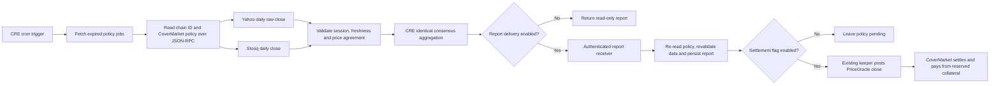

# Optional Chainlink CRE settlement workflow

InsureVEX's CRE workflow checks expired protection policies against two external price sources before supplying a closing price to the existing settlement contracts. It uses the official `@chainlink/cre-sdk`, a cron trigger, HTTP capabilities, consensus aggregation, and direct JSON-RPC policy reads. This is a CRE workflow, not a Chainlink stock Data Feed or a CCIP integration.

The feature is **off by default**. No contracts or deployed roles are changed by installing it.

## Enable the feature

In `server/.env`:

```dotenv
CHAINLINK_ENABLED=1
CHAINLINK_SETTLEMENT_ENABLED=0
CHAINLINK_CHAIN_IDS=1874,296
CHAINLINK_SYMBOLS=NASDAQ:NVDA,NYSEARCA:SPY
CHAINLINK_REPORT_TOKEN=<random-secret-at-least-32-characters>
```

Restart the server after changing configuration. `true`/`false` also work. A malformed flag fails startup rather than silently selecting a different settlement path.

| Configuration | Behaviour |
|---|---|
| `CHAINLINK_ENABLED=0` | Existing keeper behaviour. CRE status is disabled and the frontend panel is hidden. |
| `CHAINLINK_ENABLED=1`, settlement flag `0` | Validation-only mode. CRE jobs and authenticated report intake are enabled; the keeper leaves scoped policies pending. |
| Both flags `1` | The keeper can post validated closes and settle scoped testnet policies. Missing, stale or conflicting reports leave them pending. |

The flag scopes policies by both chain and stock. Other policies keep their existing settlement path. Coupons, note maturity and NAV updates keep their existing behaviour. There is **no fallback to the single-source price path for a policy assigned to CRE**, even when a provider is unavailable.

`CHAINLINK_SETTLEMENT_ENABLED=1` permits testnet transactions from the configured keeper. It should only be enabled after configuring and testing the workflow and report delivery. A flag change does not revoke existing oracle/reporting roles or stop someone calling the existing contracts directly.

## Workflow



The workflow processes **one policy per run** to bound capability calls. It verifies the RPC's chain ID and the policy's symbol, expiry, open status and start price; it pins the market and oracle addresses in its configuration. It then fetches both providers and returns the midpoint of their prices when they agree within 50 basis points (0.5%). Missing, malformed, conflicting, future or stale observations throw before delivery.

The receiver independently rereads the open, expired policy and repeats validation. Accepted reports are stored in persistent SQLite. Duplicate reports are idempotent; a conflicting price for the same policy requires operator reconciliation. The keeper also refuses to overwrite or settle against an existing oracle price that conflicts with the report. Zero closes are supported when both providers agree on zero.

## Run the real CRE workflow

Prerequisites: Node.js >=22.13, Bun >=1.2.21, the official CRE CLI, and Chainlink CRE authentication (`cre login` or your `CRE_API_KEY`). Verified here with Bun 1.4.4 and CRE CLI v1.39.0. These are separate from the existing server's wallet credentials. Never put a quoter/keeper private key in the CRE workflow.

```bash
cd chainlink
npm ci
npm run typecheck
npm test
cre login
npm run simulate
```

Configure `chainlink/settlement/config.staging.json` for your merchant's jobs/report URLs and pinned deployment addresses. The supplied local URLs target port 8080. Leave `deliveryEnabled: false` for a read-only simulation. The API requires the main feature flag to be enabled and an actual open, expired, allowlisted policy to return a job; an empty job list does not demonstrate a completed settlement.

Staging discovery selects Whitechain (`?chainId=1874`) so slow Hedera RPC discovery does not consume CRE's ten-second HTTP deadline. The configured Hedera settlement path remains available when selecting its chain. When no expired job exists, the workflow reads the configured market's actual `policyCount()` and fetches a completed NVDA close from Yahoo. This single-source observation is explicitly marked `settlementAuthorised: false`; it cannot reach report delivery or move funds.

For the isolated receiver-free verification, run this in a separate terminal from the repository root:

```bash
cd server
PORT=8082 KEEPER=0 QUOTER_PRIVATE_KEY='' PRIVATE_KEY='' X402_ENABLED=0 CHAINLINK_ENABLED=1 CHAINLINK_SETTLEMENT_ENABLED=0 node src/index.js
```

Then from another terminal:

```bash
cd chainlink
cre workflow simulate ./settlement --target local-simulation --non-interactive --trigger-index 0
```

This uses actual Whitechain contracts and actual Yahoo HTTP data. Both read-only targets have an empty `secrets-path`, so no payment-relay secret is required. CLI v1.39 requires a supported EVM RPC at startup even for HTTP-only workflows; `project.yaml` therefore uses the official template's Sepolia public RPC solely for host bootstrap. All insurance policy reads use the pinned Whitechain/Hedera endpoints in workflow config, not that Sepolia RPC.

For authenticated delivery:

1. Set `deliveryEnabled: true` in the workflow configuration.
2. Set `CHAINLINK_REPORT_TOKEN` in the workflow's secret configuration (`chainlink/.env` for local simulation), matching the server's secret. `chainlink/secrets.yaml` declares the secret name only.
   Set the delivery target's `workflow-artifacts.secrets-path` to `../secrets.yaml`; the checked-in staging/local targets deliberately do not load credentials. Never enable delivery on `local-simulation`.
3. Keep `CHAINLINK_SETTLEMENT_ENABLED=0` while checking `/api/chainlink/status` and the Agent page's CRE panel.
4. Enable the settlement flag explicitly and restart the server only when you intend the keeper to submit testnet transactions.

The workflow reads Whitechain/Hedera using HTTP JSON-RPC. This does **not** claim native CRE EVM-capability or DON deployment support for either network. Before deployment, verify CRE quotas, allowed endpoints and network capabilities. A normal CLI simulation is not a deployed DON workflow. A simulation with delivery enabled can make real HTTP requests; it must point to a validation-only receiver unless real testnet writes are intended.

## API and UI

| Endpoint | Purpose |
|---|---|
| `GET /api/chainlink/status` | Mode, scope, accepted reports and settlement receipts; no secrets |
| `GET /api/chainlink/jobs` | Up to ten open, expired jobs across enabled chains; workflow consumes one |
| `POST /api/chainlink/reports` | Bearer-authenticated report intake; independently verifies policy and observations |

`/api/health` exposes `features.chainlink`. The Agent page shows a CRE settlement panel only when the server flag is enabled. It distinguishes validation-only mode from operator-relayed settlement and links confirmed settlements to their explorer.

## Trust boundaries and limitations

- **Report delivery is an authenticated operator relay.** The bearer token is not a Chainlink DON signature. Someone controlling that token can submit fabricated source attestations; production must verify CRE-signed reports or use a properly authorised on-chain CRE receiver. This addition does not make the current testnet oracle trustless.
- **Initial scope is US stocks/ETFs in USD**, on Whitechain/Hedera testnets. The adapter assumes regular US equity closing hours with modern US daylight saving rules. It deliberately rejects holiday/early-close windows around July 4, Thanksgiving and Christmas rather than inventing an exchange calendar. Other markets require proper exchange-calendar adapters.
- **Sources are external providers, not exchange-signed truth.** Yahoo raw daily closes are used rather than adjusted closes or live trades. Stooq's historical adjustments or source outages may cause disagreement; the safe result is a pending policy. Two APIs do not guarantee independent upstream data.
- **Observation freshness is five minutes**, with a 30-second future clock tolerance. Both providers must identify the same completed session no more than four days before expiry.
- **Demo scanning is bounded to 500 policies**, with one policy processed per workflow execution. Add an indexer and queue scheduling before scaling. In validation-only mode the same open policy may be returned repeatedly until it is settled or the mode changes.
- **Persistent single-instance server required.** No ephemeral/serverless fallback exists for report state. Conflicting stored reports require manual reconciliation; no public endpoint clears them.
- **SDK dependency note:** the pinned official CRE SDK depends on Zod 3, which currently has a high-severity collection-validation advisory. We bound HTTP response size and job count before schema validation. Upgrading it blindly to Zod 4 breaks the SDK's runtime bindings; review the upstream fix before a production deployment.

## Verification and submission status

The server tests cover flag defaults, scope, stale/conflicting prices, session mismatches, zero closes, bearer authentication, report idempotency, and keeper routing with no legacy fallback. The workflow tests use the **official CRE SDK test runtime and HTTP capability mock** to exercise blockchain reads, both provider adapters, consensus aggregation and delivery. Fixtures are test data, not live market evidence.

The authenticated **real CRE CLI simulations passed** against deployed Whitechain contracts and live Yahoo data: [staging output](evidence/chainlink-cre-staging-simulation.txt), [local-target output](evidence/chainlink-cre-local-simulation.txt). The workflow logged five policies and NVDA's completed November 5 close, with no settlement authorised because no scoped policy had expired. These are CLI execution logs, not SDK mocks. **DON deployment and live CRE-driven settlement have not been completed.** The [CRE bounty](https://ethglobal.com/events/mumbai/prizes/chainlink) accepts successful simulation; the demo must explain the actual insurance-market monitoring role and the distinction from the separately tested settlement path.

### Repeatable local end-to-end check

Install dependencies in `contracts`, `server` and `chainlink`, then run:

```bash
cd server
npm run chainlink:e2e
# If Bun is not on PATH: BUN_BIN=/absolute/path/to/bun npm run chainlink:e2e
```

This deploys actual contracts to an ephemeral in-process Hardhat EVM, buys signed cover with local test tokens, and runs the official CRE SDK handler against the actual HTTP API and EVM policy reads. Only the market prices and SDK capability transport are fixtures. It checks durable report storage, validation-only and missing-report guards, oracle posting, the exact holder payout, Pro first loss, collateral release, replay protection, and the disabled feature's legacy settlement path. It uses no operator keys and does not touch running services. Results are written to [`evidence/chainlink-local-e2e.json`](evidence/chainlink-local-e2e.json); its transaction hash is local evidence, not an explorer receipt.

On November 6, 2026, 30 server tests, 12 contract tests, six CRE workflow tests, typechecking, the frontend build, and the local end-to-end check passed. CRE CLI login and real read-only simulations are now verified. A live Yahoo probe succeeded, but Stooq returned an HTTP 403/browser-verification page. Therefore **live two-source settlement is blocked in this environment** until a supported machine-accessible second source is configured and validated. Do not weaken the two-source requirement or present fixture prices as live data.

When using a separate persistent agent server, set `NEXT_PUBLIC_AGENT_API_URL` in `app/.env.local` to that server's origin (for example `http://localhost:8081`). Agent discovery, controls and signatures use that origin; ordinary pricing and Chainlink status continue to use `NEXT_PUBLIC_API_URL`. Production frontend builds require rebuilding after public environment changes.

Deployment access is currently not enabled for the authenticated organization. It is not needed for the successful CLI simulations above. For later Early Access, run `cre account access --help`, then `cre account access` from an interactive terminal and follow the request prompts. The access command needs a TTY; do not invent a submission flag. Requesting access does not deploy the workflow. No deploy, activate, secret-upload, or workflow-upload command was run during this verification.

References: [CRE documentation](https://docs.chain.link/cre), [official CRE templates](https://github.com/smartcontractkit/cre-templates), [official TypeScript SDK](https://github.com/smartcontractkit/cre-sdk-typescript).
