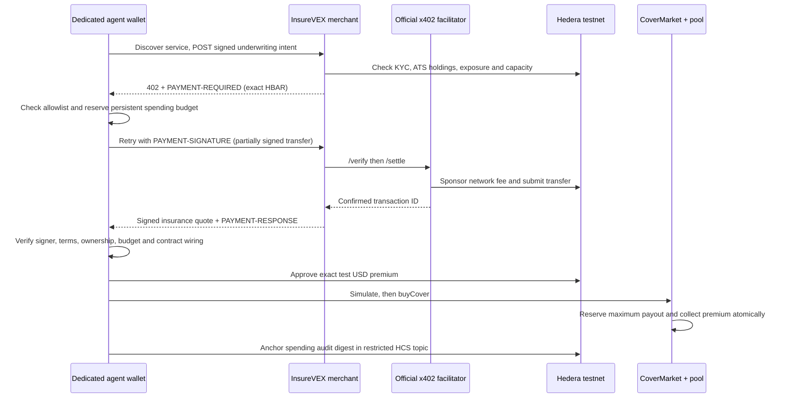

# InsureVEX: autonomous underwriting and insurance payments on Hedera

This integration adds an autonomous policy agent to the existing InsureVEX insurance product. The client discovers a paid underwriting service, handles an HTTP 402 challenge without per-payment human approval, receives an EIP-712 quote, and purchases collateralised stock protection through the existing CoverMarket.

The runtime is a deterministic policy agent: it uses the existing empirical pricing engine and explicit decision rules. It does not give a language model access to keys or unrestricted transaction tools. Hedera's track explicitly accepts an agent **or client** completing an autonomous paid request.

## Payment architecture



There are two distinct payments:

1. **Underwriting service:** 1,000,000 tinybars = 0.01 test HBAR, paid through the official Hedera x402 `exact` scheme. The facilitator sponsors the network fee.
2. **Insurance premium:** test USD paid through `CoverMarket.buyCover`. Keeping this in the existing contract preserves atomic collateral reservation and policy issuance. The agent pays the gas for these EVM transactions. x402 does not replace the premium or create an uncollateralised policy.

The agent has no ability to post oracle prices, approve identities, change risk parameters, withdraw pool assets, or invent a crash payout. Insurance payouts follow the existing expiry/oracle/settlement contracts. This integration purchases real testnet policies; it does not fabricate a crash for the demo.

## Setup

Use Node.js **22.13 or newer** (tested with 24.4.1) and a persistent local machine or VM. SQLite stores replay prevention, in-flight request state and budgets. Payment mode deliberately refuses Vercel/serverless because ephemeral state cannot provide these guarantees. Existing non-agent APIs can still use their existing deployment path.

```bash
cd server
npm ci
cp .env.example .env  # preserve an existing .env; set the testnet issuer QUOTER_PRIVATE_KEY
npm test
npm run agent:setup
```

The provisioning script uses the existing testnet issuer to create a **separate ECDSA agent account**, fund it with 3 test HBAR and 10 test USD, approve its demo identity, issue one test ATS NVIDIA share, and create an HCS topic whose submit key belongs to the agent. It does not grant the agent administrative roles. Native account creation has a 2-HBAR maximum fee; other native provisioning operations cap fees at 0.5 HBAR. This is an issuer-run testnet fixture, not real KYC.

Credentials and pinned policy are stored with private permissions in `server/.agent-state/`, which is gitignored. Never copy this directory into a public repository. `policy.json` contains the exact merchant, facilitator fee payer, origin and contract allowlist. The setup script prints the merchant account to use:

```bash
# Terminal 1, server directory
X402_ENABLED=1 X402_MERCHANT_ACCOUNT=<account-printed-by-setup> KEEPER=0 npm start

# Terminal 2, server directory
npm run agent:plan  # read-only chain preflight
npm run agent:run   # one autonomous paid underwriting + insurance purchase

# Optional UI, app directory
npm ci
npm run build
npm start
# Open http://localhost:3000/agent
```

`KEEPER=0` isolates the demo from the existing multi-chain oracle/coupon automation. Expiry settlement still uses the existing keeper when enabled by an operator. No keeper or issuer key is ever used as the paying agent key.

For a hosted merchant, set `X402_PUBLIC_ORIGIN` to its HTTPS origin and pin the same origin in the agent's local policy. The agent rejects redirects, unexpected payment destinations and alternate facilitator fee payers. The deployed merchant needs `X402_ENABLED=1`, a merchant account, an issuer quoter, and a persistent SQLite path; it does not need the agent's private key.

## Guardrails

| Control | Enforced behaviour |
|---|---|
| Environment | Hedera testnet only; actual RPC `eth_chainId` is checked before insurance operations |
| Runtime privileges | Dedicated wallet; rejects issuer/quote/KYC/pool management roles |
| Merchant | Exact configured origin, account, facilitator and sponsored fee payer |
| Asset | x402 service accepts test HBAR only; insurance uses the pinned test USD contract |
| Underwriting | Registered ATS NVIDIA equity only; no self-reported brokerage attestations |
| Ownership | On-chain balance minus shares already insured must cover the new policy |
| Position size | At most 0.1 shares and $25 protected per policy; default request is 0.01 shares |
| Terms | Seven days, 10% payout cap, allowlisted deductible; at most three open policies |
| Premium limits | $1 per policy and $2 per UTC day, persisted before signing |
| Service limits | 0.01 HBAR per call and 0.05 HBAR per UTC day, persisted before signing |
| Gas limits | At most 1 HBAR per insurance transaction and 2 HBAR per UTC day, reserved conservatively from gas estimates |
| Allowance | Starts with zero allowance; approves exactly the quoted premium; rejects unlimited approvals |
| Contract calls | Only bounded `approve` to the pinned market and `buyCover`; no native-value or administrative calls |
| Identity and pause | Checks KYC, paused contracts, and contract wiring before buying |
| Quote integrity | Buyer-signed intent, server EIP-712 signature, authorised quoter role, exact requested terms, expiry, and fresh data |
| Collateral | Reads symbol/market capacity; existing contracts enforce reserves and full collateralisation atomically |
| Replay and races | Durable unique request IDs and native payment transaction IDs; SQLite atomic claims prevent concurrent settlement |
| Unknown outcomes | Fail closed; pending budgets remain consumed; persistent wallet lock prevents another run |
| Kill switch | `AGENT_KILL_SWITCH=1` or the configured STOP file, checked before new signing/submission steps |
| Audit | Hash-linked local audit records; final digest anchored in HCS with an agent-only submit key |

Lower limits can be set in the local agent policy; the runtime rejects limits above the service's hard ceilings. Daily budgets use UTC. They are local wallet policy controls, not an on-chain spending vault: anyone who steals the raw private key can bypass the client. Keep only test assets in this wallet.

The merchant validates the transfer shape locally and delegates cryptographic payer-signature verification, balance checking, fee sponsorship, and consensus settlement to the official facilitator. The client never submits a transaction to a user-provided facilitator URL.

## Emergency stop and reconciliation

Create `server/.agent-state/STOP` to stop new agent operations. Stop files cannot cancel transactions already signed or submitted.

After any uncertain outcome:

1. Stop the agent and merchant.
2. Inspect `spending` and `locks` in `.agent-state/agent.sqlite`; inspect `requests` in `.agent-state/merchant.sqlite`.
3. Look up the recorded transaction ID/hash on Hedera testnet HashScan or the Mirror Node. Do not assume an HTTP timeout means no payment occurred.
4. Check `nonceUsed`, existing policies, and stablecoin allowance. An interrupted run after approval may leave a small exact allowance; clear it with the wallet before buying again.
5. Reconcile records and clear the specific wallet lock only after determining the outcome. Do not delete databases to reset budgets. The runtime does not automatically refund unknown reservations or retry settlement.

The merchant can return a completed request idempotently within its intent validity window. A request stuck in `settling` or `unknown` deliberately requires operator reconciliation. The agent's reservations remain counted even when a subsequent action fails. Back up the SQLite files; run only one configured merchant instance against its database.

## Validation and track requirements

`npm test` covers hostile requirements, budget persistence, duplicate spending IDs, emergency stop, quote tampering, actual SDK transaction decoding, HTTP 402 negotiation, concurrent duplicate requests, idempotent responses, unknown settlement outcomes and invalid intent signatures. The existing Hardhat lifecycle/security tests remain unchanged.

| Hedera requirement | Implementation / evidence |
|---|---|
| Protected endpoint settles on Hedera | `POST /api/agent/underwrite`, official `https://x402.org/facilitator`, `hedera:testnet` |
| Autonomous paid client | `npm run agent:run`, no per-payment approval or checkout |
| Public repo with setup, architecture and payment flow | Root README and this document; publish the changes to the public repository before submission |
| Settled Hedera transaction ID | Recorded in `last-run.json`; sanitised evidence is published alongside the demo |
| Demo <= five minutes, showing settlement + HashScan | See the demo/evidence links in the root README |
| Extra: spending controls | Persistent budgets, per-call caps, merchant/contract allowlists, emergency stop |
| Extra: HCS audit | Agent-key-restricted topic with spending-log digest |

HTS USDC, HCS-14/ERC-8004 identity, multi-agent negotiation, and scheduled recurring x402 payments are not claimed. Existing ATS and scheduled bond coupon work is separate from this integration.

Sources: [Hedera prize requirements](https://ethglobal.com/events/mumbai/prizes/hedera), [Hedera exact scheme](https://docs.hedera.com/solutions/ai/x402/exact-scheme), [client setup](https://docs.hedera.com/solutions/ai/x402/pay-with-x402), [facilitators](https://docs.hedera.com/solutions/ai/x402/facilitators), and [reference protocol specification](https://github.com/x402-foundation/x402/blob/main/specs/schemes/exact/scheme_exact_hedera.md).
